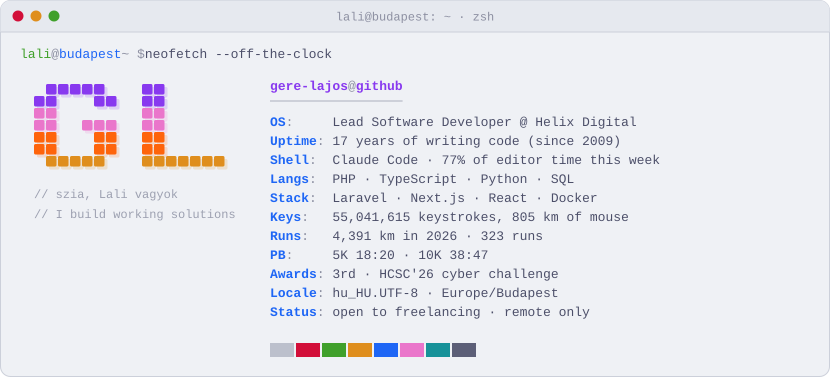
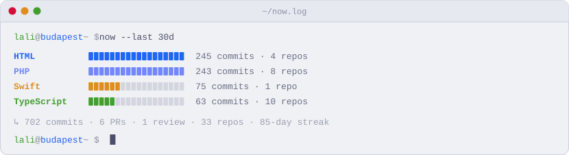
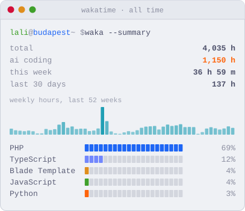
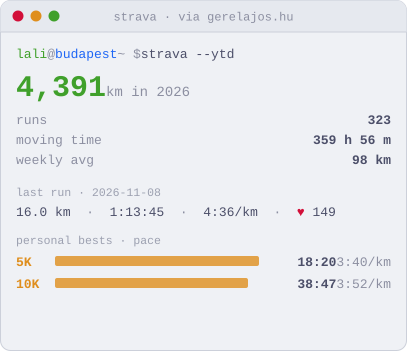
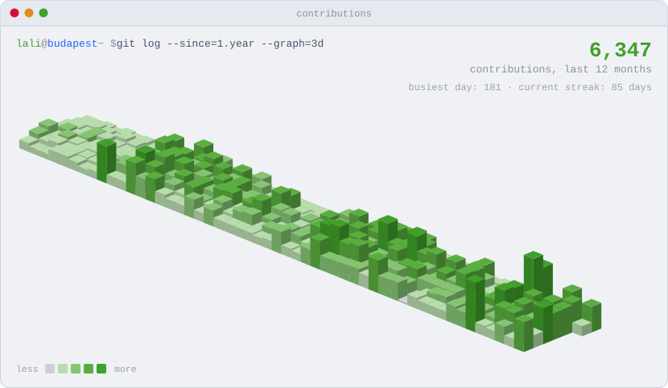

<!-- Cards are generated daily by .github/workflows/profile.yml (scripts/generate.py). -->

<picture>
  <source media="(prefers-color-scheme: dark)" srcset="assets/cards/neofetch-dark.svg">
  
</picture>

<picture>
  <source media="(prefers-color-scheme: dark)" srcset="assets/cards/now-dark.svg">
  
</picture>

<picture>
  <source media="(prefers-color-scheme: dark)" srcset="assets/cards/waka-dark.svg">
  
</picture>
<picture>
  <source media="(prefers-color-scheme: dark)" srcset="assets/cards/run-dark.svg">
  
</picture>

<picture>
  <source media="(prefers-color-scheme: dark)" srcset="assets/cards/contrib-dark.svg">
  
</picture>

[gerelajos.hu](https://gerelajos.hu) · [LinkedIn](https://www.linkedin.com/in/gere-lajos/) · [hello@gerelajos.hu](mailto:hello@gerelajos.hu) · [the5krunner feature](https://the5krunner.com/2026/07/13/negative-split-strava/)

// készült Budapesten 🇭🇺 · data: GitHub · WakaTime · Strava via gerelajos.hu · refreshed daily
