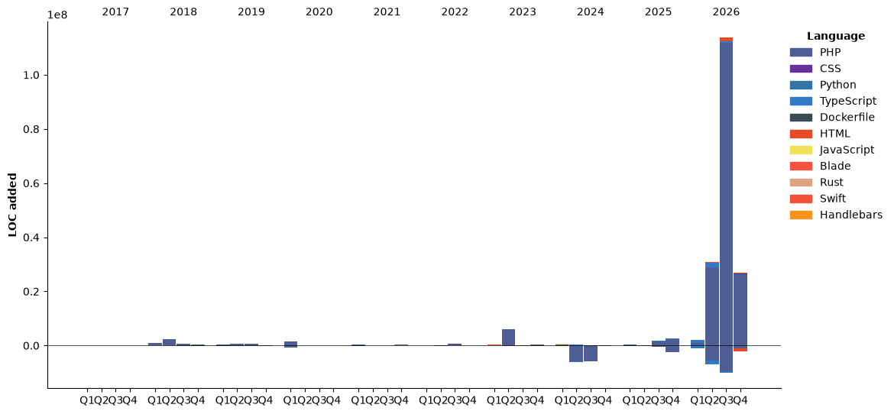

[](https://github.com/Akshay090/svg-banners)

<!--START_SECTION:waka-->


**🐱 My GitHub Data** 

> 📦 1.1 MB Used in GitHub's Storage 
 > 
> 🏆 5,840 Contributions in the Year 2026
 > 
> 💼 Opted to Hire
 > 
> 📜 6 Public Repositories 
 > 
> 🔑 82 Private Repositories 
 > 
**I'm an Early 🐤** 

```text
🌞 Morning                40684 commits       ████████████░░░░░░░░░░░░░   49.06 % 
🌆 Daytime                33397 commits       ██████████░░░░░░░░░░░░░░░   40.28 % 
🌃 Evening                8610 commits        ███░░░░░░░░░░░░░░░░░░░░░░   10.38 % 
🌙 Night                  228 commits         ░░░░░░░░░░░░░░░░░░░░░░░░░   00.27 % 
```
📅 **I'm Most Productive on Tuesday** 

```text
Monday                   14277 commits       ████░░░░░░░░░░░░░░░░░░░░░   17.22 % 
Tuesday                  20366 commits       ██████░░░░░░░░░░░░░░░░░░░   24.56 % 
Wednesday                14271 commits       ████░░░░░░░░░░░░░░░░░░░░░   17.21 % 
Thursday                 13402 commits       ████░░░░░░░░░░░░░░░░░░░░░   16.16 % 
Friday                   14847 commits       ████░░░░░░░░░░░░░░░░░░░░░   17.91 % 
Saturday                 3562 commits        █░░░░░░░░░░░░░░░░░░░░░░░░   04.30 % 
Sunday                   2194 commits        █░░░░░░░░░░░░░░░░░░░░░░░░   02.65 % 
```


📊 **This Week I Spent My Time On** 

```text
💬 Programming Languages: 
Other                    26 hrs 34 mins      ██████████████░░░░░░░░░░░   57.93 % 
Markdown                 10 hrs 52 mins      ██████░░░░░░░░░░░░░░░░░░░   23.71 % 
HTML                     3 hrs 3 mins        ██░░░░░░░░░░░░░░░░░░░░░░░   06.67 % 
Python                   2 hrs 8 mins        █░░░░░░░░░░░░░░░░░░░░░░░░   04.67 % 
TypeScript               1 hr 49 mins        █░░░░░░░░░░░░░░░░░░░░░░░░   03.96 % 

🔥 Editors: 
Claude Code              44 hrs 13 mins      ████████████████████████░   96.42 % 
Codex Exec               1 hr 10 mins        █░░░░░░░░░░░░░░░░░░░░░░░░   02.56 % 
Codex Vscode             28 mins             ░░░░░░░░░░░░░░░░░░░░░░░░░   01.02 % 

💻 Operating System: 
Mac                      45 hrs 52 mins      █████████████████████████   100.00 % 
```

🤖 **AI Coding This Week** 

```text
⏱ AI Coding Time: 45 hrs 52 mins (100.0%)

✍️ 6,970 lines written by AI, 0 lines written by hand (100.0% AI-written)

🔤 8,088,921 Input Tokens, 1,013,437 Output Tokens

💵 $222.14 Estimated AI Cost This Week

🧠 187 AI Sessions, 423 AI Prompts

Opus                     7,579 lines         █████████████████████████   100.00 % 
GPT                      0 lines             ░░░░░░░░░░░░░░░░░░░░░░░░░   00.00 % 
Sonnet                   0 lines             ░░░░░░░░░░░░░░░░░░░░░░░░░   00.00 % 
Haiku                    0 lines             ░░░░░░░░░░░░░░░░░░░░░░░░░   00.00 % 
Codex-Exec               0 lines             ░░░░░░░░░░░░░░░░░░░░░░░░░   00.00 % 

🔎 AI Coding Insights:
🤖 AI-Driven — 100.0% of written lines came from AI
📚 Verbose Prompter — average 2,114 characters per prompt
🔁 Iterative Prompter — average 2 prompts per session
🚀 High AI Trust — 0.0% of changed lines were hand-edited
```

**I Mostly Code in PHP** 

```text
TypeScript               19 repos            ██████░░░░░░░░░░░░░░░░░░░   22.09 % 
JavaScript               8 repos             ██░░░░░░░░░░░░░░░░░░░░░░░   09.30 % 
HTML                     6 repos             ██░░░░░░░░░░░░░░░░░░░░░░░   06.98 % 
Rust                     2 repos             █░░░░░░░░░░░░░░░░░░░░░░░░   02.33 % 
Shell                    1 repo              ░░░░░░░░░░░░░░░░░░░░░░░░░   01.16 % 
```


**Timeline**




 Last Updated on 01/11/2026 18:54:57 UTC
<!--END_SECTION:waka-->
